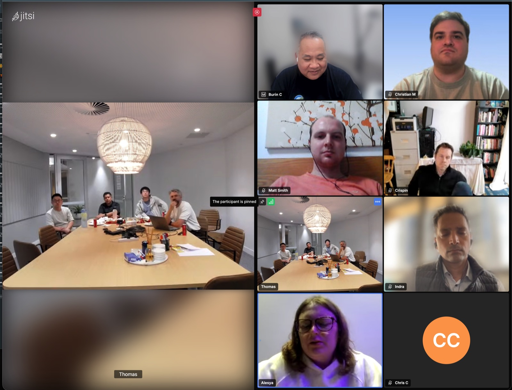

# clj-aus #2: Jolt since September, and Clojure on the Wii

**Tuesday 24 November 2026, 7:00–8:30pm AEDT · Online**
[Meetup event](https://www.meetup.com/clojure-australia/events/317297998/)

## How it went

12 people came, some from home and a group together in one meeting room, and
the session ran for almost an hour and a half. The Wii project went open
source on the night as planned. We met on our own Jitsi Meet server, stood up
in Sydney for the event, so the call had no time limit.

## Talk

**Jolt since September.** Session #1 ran raylib under three native Clojures,
and one of them was [Jolt](https://github.com/jolt-lang/jolt), Clojure on Chez
Scheme. This is a quick tour of what it can do now without a JVM, using
[awesome-jolt](https://github.com/jlt-commons/awesome-jolt) as the map:
PostgreSQL and SQLite, Ring, reitit-core and clj-http-lite unmodified, Transit
and Fressian, and OpenTelemetry.

**Clojure on the Wii.** The Wii has a 32-bit big-endian PowerPC. Jolt had run
on 32-bit before, but never on a big-endian machine or built from another one,
so the talk walks through what that took, then plays four games live in the Dolphin emulator:
Balloon Pop, Star Catcher, Shake Race and Super Mona. The project goes open
source on the night.

## Source

[b12n-oss/wii-jolt](https://github.com/b12n-oss/wii-jolt) went public on the night. It has every game, the
Chez Scheme patch, the Jolt build for the Wii, and guide pages from getting
started to running a game on your own console.

The Jolt fixes the talk mentions are upstream:
[jolt-lang/jolt#1514](https://github.com/jolt-lang/jolt/pull/1514) (the 32-bit cross build) and
[jolt-lang/jolt#1831](https://github.com/jolt-lang/jolt/pull/1831) (the hash on the Wii).

## Slides

[clojure-on-the-wii.pdf](./clojure-on-the-wii.pdf), one page per slide. Each page is an
image, so the links in it can't be clicked. The live clips show as stills.

## Recording

The session was recorded. It needs editing before it goes online, and where
it will be hosted isn't decided yet.
